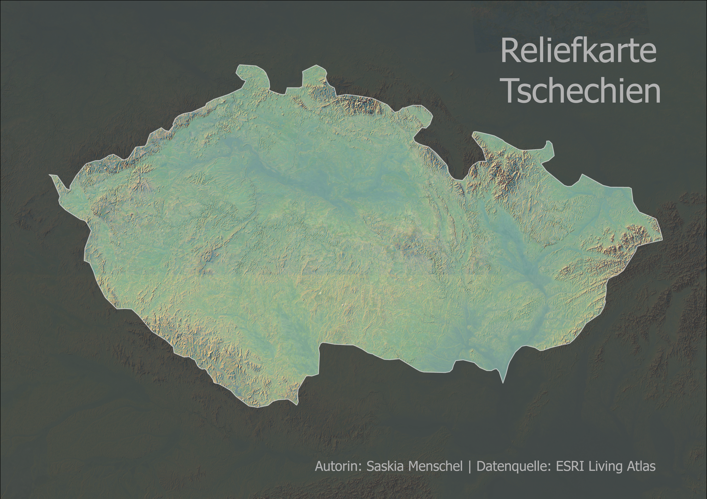

# 	 Geländedarstellung und 3D-Datenvisualisierung WiSe 26/27
## EP01 | Geländedarstellung I

### Digitales Höhenmodelll des nevado de toluca

### 3D-Reliefanalyse eines Stratovulkans

Diese Arbeit befasst sich mit der digitalen Geländedarstellung des mexikanischen Stratovulkans Nevado de Toluca. Ziel war es, die prägnanten Höhenunterschiede zwischen der Geländebasis auf rund 1.865 Metern und den hochgelegenen Gipfelregionen bei 4.665 Metern plastisch herauszuarbeiten.

### Methodische Umsetzung:

Das digitale Höhenraster wurde mit einem durchgehenden Hypsometrie-Farbverlauf symbolisiert, der von satten Grüntönen in den Niederungen bis zu hellen Ockertönen in den Hochlagen reicht. Durch die Überlagerung mit einer eigenständig berechneten Standard-Schummerung treten Hangneigungen, Felsgratstrukturen und die tiefen Kraterränder der Vulkanlandschaft anschaulich hervor.

## EP02 | Geländedarstellung II

### Relief Tschechien

### Plastische Reliefvisualisierung der tschechischen Topografie

Die Karte zeigt eine freigestellte Reliefdarstellung der Republik Tschechien im Imhof-Stil. Im Fokus steht die deutliche Ausprägung der geografischen Kesselstruktur – umrahmt von den Mittelgebirgszügen wie dem Böhmerwald, dem Erzgebirge und den Sudeten im Gegensatz zum flacheren Binnenland.

### Methodische Umsetzung:

Auf Basis von Höhendaten und Ländergrenzen aus dem ESRI Living Atlas wurde das Projekt in ArcGIS Pro in einer flächentreuen Lambert-Projektion angelegt. Über Spatial-Analyst-Tools wurden die Neigung und mehrstufige Schummerungen berechnet. Durch die feine Kombination aus DEM-Hypsometrie im Mist-Farbband, transparentem Neigungs-Layer und multispektraler Schummerung sowie einer dunklen Hintergrundmaskierung entsteht ein starker Dreidimensionalitätseffekt im finalen Layout.

